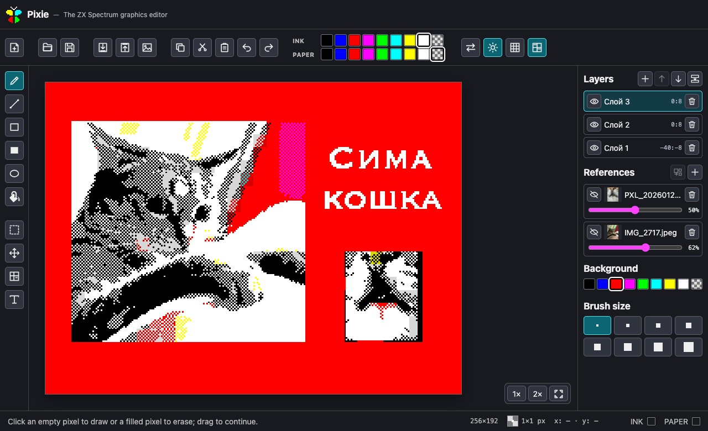
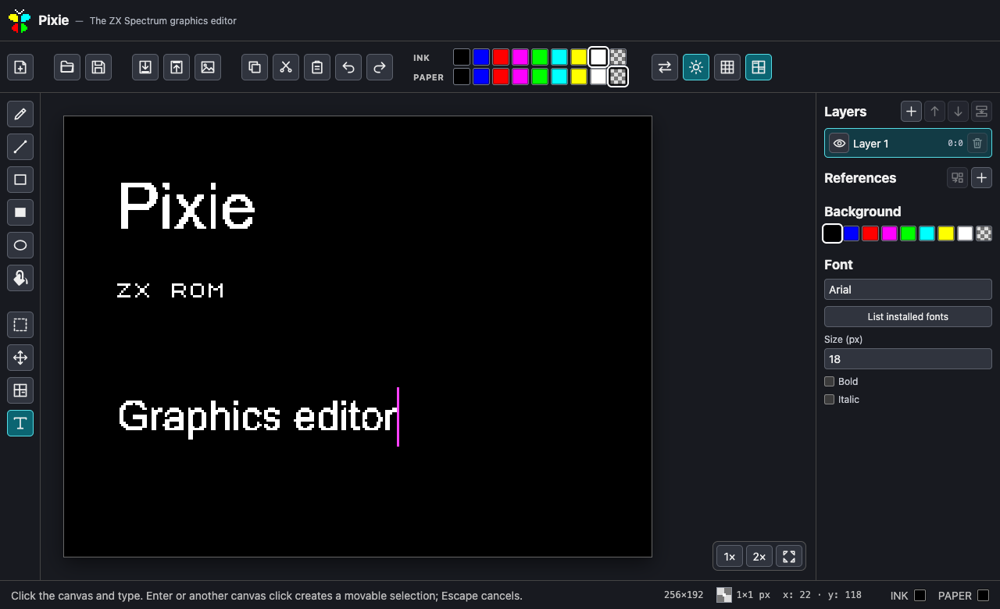
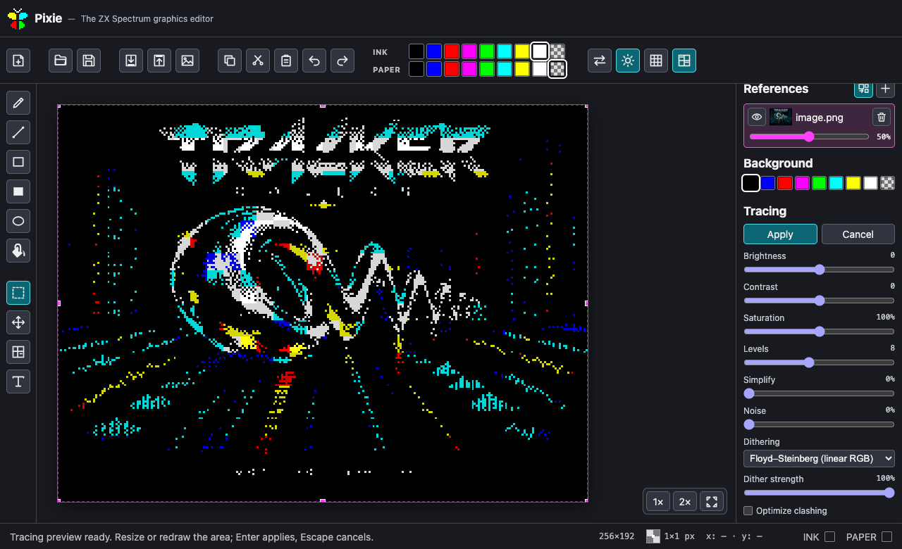

#  Pixie — ZX Spectrum graphics editor

**[Open Pixie in your browser](https://anteo.github.io/pixie/)** · No installation or build step. You can also download the repository and open `index.html` locally.

Pixie lets you draw at individual pixel resolution while seeing how the result will look on a real ZX Spectrum screen. It supports the standard 256×192 bitmap and its 8×8 color attributes, with a switchable ZX attribute preview. Smaller canvases are available for artwork that does not need to fill the screen.

## Screenshots

Click a preview to open it at full size.

<table>
  <tr><th>ZX screen artwork</th><th>Pixel fonts</th><th>Drawing shapes</th><th>Reference tracing</th></tr>
  <tr>
    <td></td>
    <td></td>
    <td></td>
    <td></td>
  </tr>
</table>

## What you can do

- **Canvas.** Create a full 256×192 ZX screen or a smaller document.
- **Pixel brush.** Click an empty pixel to draw or a filled pixel to erase; dragging continues the action chosen by the first pixel.
- **Text.** Choose the ZX ROM font or render a browser font into pixels. You can request the installed font list where the browser supports it, or enter a font family manually. Enter or a canvas click creates a floating selection that you can move or resize before applying. Hold Shift when placing text to align its start to an 8×8 cell.
- **INK and PAPER.** Choose colors from swatches and switch BRIGHT on or off.
- **ZX attribute preview.** When rendering the visible layers together, encode their composition using ZX screen attributes. Each layer itself always keeps attributes per 8×8 cell; switching the preview does not change that. PNG export follows the preview, while SCR export always uses ZX encoding.
- **Layers.** Show, hide, rename, move, reorder, merge, and delete layers from their rows. Layer content can extend beyond the document while you move and edit it; exports show only the document area. The visibility button cycles **on → off → solo** and shows the letter S in solo state; `V` cycles the active layer. Several layers can be solo at once.
- **Reference images.** Load PNG, JPEG, WebP, or GIF images beneath the drawing and above the background. Each reference has its own visibility and opacity; drag rows in the right panel to reorder them. Select a reference to move it by its image or frame, or resize it from a corner. Hold Shift to preserve its proportions. References scale with the canvas and are excluded from SCR and PNG exports.
- **Trace a reference.** Select a reference and click the trace button (`K`); tracing also works when its visibility is off. Pixie immediately previews its full area, or the current selection if one exists. Drag the frame edge to move it, a handle to resize it, or start a new selection inside or outside the frame. Undo/redo steps through changes to the tracing frame and settings without leaving tracing. **Apply** or Enter commits pixels to the active layer; **Cancel** or Escape discards the preview. Other references are hidden during tracing. Copy takes the traced pixels without applying them; Cut copies them and cancels tracing. Reference opacity does not affect converted pixels.
- **Trace controls.** The trace button reveals controls for brightness, contrast, saturation, levels, simplification, noise, dithering, and neighboring cell color consistency in the right panel. Choose linear RGB Floyd–Steinberg, Sierra, Atkinson, Bayer 4×4/8×8, checker dithering, or no dithering. Controls update a floating trace immediately.
- **Selections.** Copy, cut, erase, and move a selected region. Arrow keys nudge it by one pixel; Shift+arrow keys snap it to the next 8×8 cell boundary. Moved artwork stays floating until Enter or deselection applies it.
- **Resize selections.** Drag the frame edges or corners to scale the pixels; hold Shift to snap the size to multiples of 8. Until applied, each resize uses the original selected pixels, so shrinking and enlarging again does not compound the loss of detail.
- **Polylines.** Click successive points to draw connected segments, or drag for a single segment. Hold Shift for horizontal, vertical, or 45° lines; press Escape to end the polyline.
- **Rectangles.** Draw an outline or a filled rectangle with two clicks or one drag. The size is shown beside the pointer while drawing.
- **Ellipses.** Draw an outline with two clicks or one drag; hold Shift for a circle. The selected brush width applies to the outline.
- **Flood fill.** Fill a connected region of the active layer, using its pixel colors and transparency as boundaries.
- **Transparency.** Use transparent INK or PAPER and per-pixel layer masks to reveal artwork below. Drawing with transparent PAPER preserves existing paper pixels and their color.
- **Attribute painting.** Apply the brush, line, rectangle, ellipse, or fill tools to whole 8×8 attribute cells without changing the selected tool.
- **Solo preview.** With ZX preview on, all enabled layers are rendered together with ZX attributes; that result is dimmed outside the solo layers. Solo pixels remain at full brightness and follow layer order, while other rows in the layer panel become translucent. With ZX preview off, the dimmed area uses normal layer compositing. Solo is a canvas preview; exports retain the normal visible-layer image.
- **Right-button eraser.** Right-click or right-drag to force erasing with the brush, rectangles, or ellipse. Right-click with the fill tool erases a connected area. The polyline tool does not use the right button.
- **Brush size.** Choose a shared 1–8 pixel width in the right panel when a drawing tool is active.
- **Grid.** Show 8×8 cell boundaries and, at high zoom, individual pixel boundaries.
- **Zoom and pan.** Pinch to zoom, scroll to pan, or use keyboard zoom presets from 1× to 9×.
- **Undo and redo.** Revert drawing, layer changes, and selections. During an unfinished drag or shape preview, Undo cancels that action first.
- **Unsaved changes.** Creating a document, opening another project, or importing SCR asks whether to save when the current artwork has changed. A newly imported SCR counts as unsaved until the project is saved as `.pixie`.

## Files

| Format | Use |
| --- | --- |
| `.pixie` | Save and reopen the editable project: canvas size, layers, transparency, solo state, embedded reference images, trace settings, and preview setting. The file contents are TOML. |
| `.scr` | Import or export a standard 6,912-byte ZX Spectrum screen. Export requires a full 256×192 canvas. |
| `.png` | Export the visible image, including transparency. The ZX preview switch determines whether colors are encoded to 8×8 attributes first. |

In browsers with the File System Access API, the first project save opens a file picker; later saves write to that same `.pixie` file. Opening a project through the editor also keeps its file handle for saving. Other browsers use a download instead and cannot overwrite an existing local file directly.

The ZX Spectrum can store only one INK/PAPER color pair and one BRIGHT setting per 8×8 cell. Colors from overlapping or shifted layers may therefore be approximated when ZX preview is enabled or when exporting SCR. Merging layers also encodes the result to ZX attributes.

## Quick start

1. [Open Pixie](https://anteo.github.io/pixie/) or open `index.html` from a local copy.
2. Create a document or import an SCR screen.
3. Save your work as `.pixie`; export `.scr` or `.png` when you need a finished image.

| Shortcut | Action |
| --- | --- |
| `B`, `D`, `R`, `F`, `E`, `P`, `S`, `M`, `T` | Brush, polyline, rectangle, filled rectangle, ellipse, fill, selection, move layer, text |
| `A`, `Z`, `G` | Attribute painting, ZX preview, grid |
| `K`, `Enter`, `Escape` | Start tracing the selected reference; apply or cancel the preview |
| `Arrow keys`, `Shift+arrow keys` | Move a selection by 1 pixel or to the next 8×8 cell boundary; move the layer when the Move Layer tool is active; otherwise scroll the canvas (Shift scrolls faster) |
| `Enter` | Apply a floating selection and dismiss its outline |
| `Alt+1`…`Alt+9`, `Alt+0` | Set zoom; fit the canvas |
| `Alt+Shift+1`…`Alt+Shift+8` | Choose a 1–8 pixel brush size |
| `L`, `Shift+L`, `Shift+M` | Add layer, delete layer, merge with layer below |
| `Cmd/Ctrl+O`, `Cmd/Ctrl+S` | Open or save a Pixie project |
| `Cmd/Ctrl+Shift+O`, `Cmd/Ctrl+Shift+S` | Import or export SCR |

The interface follows the browser's language: Russian when its first preferred language is Russian, English otherwise.

## Code structure

`pixie.app.js` holds document state and coordinates editor actions. The other scripts loaded by `index.html` are grouped by responsibility:

- `pixie.core.js` handles bitmap storage, geometry, selections, ZX compositing, display output, and project data.
- `pixie.text.js` rasterizes fonts and manages text entry.
- `pixie.trace.js` converts reference images and manages tracing settings.
- `pixie.ui.js` handles panels, reference placement, zoom, file dialogs, and localization. Russian strings live in `pixie.ru.js`.

Scripts use ordinary `defer` tags in dependency order so the downloaded `index.html` still opens directly through `file://`.
