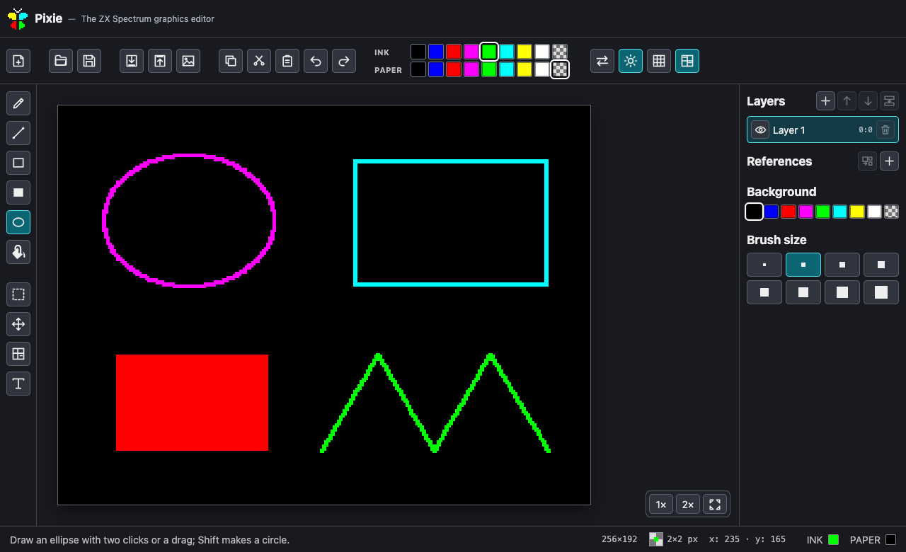

#  Pixie — ZX Spectrum graphics editor

**[Open Pixie in your browser](https://anteo.github.io/pixie/)** · No installation or build step. You can also download the repository and open `index.html` locally.

Pixie lets you draw at individual pixel resolution while seeing how the result will look on a real ZX Spectrum screen. It supports the standard 256×192 bitmap and its 8×8 color attributes, with a switchable ZX attribute preview. Smaller canvases are available for artwork that does not need to fill the screen.

## Screenshots

Click a preview to open it at full size.

<table>
  <tr><th>ZX screen artwork</th><th>Pixel fonts</th><th>Drawing shapes</th><th>Reference tracing</th></tr>
  <tr>
    <td></td>
    <td></td>
    <td></td>
    <td></td>
  </tr>
</table>

## What you can do

- **Pixel brush.** Choose a square, round, or spray tip and set its size from 1 to 64 pixels. Draw or erase depending on the first pixel touched; a drag continues that action.
- **Text.** Rasterize the ZX ROM font or browser fonts into pixels, then move or resize the text before applying it.
- **ZX attribute preview.** See the combined layers with ZX color limits. Attributes within each layer remain tied to 8×8 cells; the switch affects the composite preview and PNG export.
- **Layers.** Move, reorder, merge, and manage visibility independently. Artwork can extend beyond the document while editing.
- **Reference images.** Place images beneath the artwork, then move, resize, reorder, or adjust their opacity without including them in exports.
- **Reference tracing.** Convert the chosen reference, or a selected part of it, into a floating pixel preview on the active layer.
- **Trace controls.** Adjust color, simplification, noise, dithering, and neighboring cell color consistency with a live preview.
- **Selections.** Copy, cut, erase, and move pixels in a floating selection before applying or canceling the change.
- **Selection resizing.** Scale a selection from its original pixels, so repeated resizing does not compound detail loss.
- **Transparency.** Transparent INK and PAPER and per-pixel layer masks let lower artwork show through.
- **Attribute painting.** Use drawing tools on whole 8×8 color cells instead of individual pixels.
- **Solo preview.** Highlight one or more layers while dimming the rest, including the combined ZX rendering when attribute preview is on.
- **Polylines.** Draw connected segments, with optional horizontal, vertical, or 45° constraint.
- **Rectangles.** Draw outlines or filled rectangles.
- **Ellipses.** Draw ellipse outlines or constrain them to circles.
- **Flood fill.** Fill a connected region of the active layer.
- **Right-button eraser.** Force erasing with the brush, rectangles, ellipse, or fill tool.
- **Navigation.** Zoom and pan the canvas; a compact navigator shows the visible area when scrolling is needed.

## Files

| Format | Use |
| --- | --- |
| `.pixie` | Save and reopen the editable project: canvas size, layers, transparency, solo state, embedded reference images, trace settings, and preview setting. The file contents are TOML. |
| `.scr` | Import or export a standard 6,912-byte ZX Spectrum screen. Export requires a full 256×192 canvas. |
| `.png` | Export the visible image, including transparency. The ZX preview switch determines whether colors are encoded to 8×8 attributes first. |

In browsers with the File System Access API, the first project save opens a file picker; later saves write to that same `.pixie` file. Opening a project through the editor also keeps its file handle for saving. Other browsers use a download instead and cannot overwrite an existing local file directly.

The ZX Spectrum can store only one INK/PAPER color pair and one BRIGHT setting per 8×8 cell. Colors from overlapping or shifted layers may therefore be approximated when ZX preview is enabled or when exporting SCR. Merging layers also encodes the result to ZX attributes.

## Quick start

1. [Open Pixie](https://anteo.github.io/pixie/) or open `index.html` from a local copy.
2. Create a document or import an SCR screen.
3. Save your work as `.pixie`; export `.scr` or `.png` when you need a finished image.

| Shortcut | Action |
| --- | --- |
| `B`, `D`, `R`, `F`, `E`, `P`, `S`, `M`, `T` | Brush, polyline, rectangle, filled rectangle, ellipse, fill, selection, move layer, text |
| `A`, `Z`, `G` | Attribute painting, ZX preview, grid |
| `K`, `Enter`, `Escape` | Start tracing the selected reference; apply or cancel the preview |
| `Arrow keys`, `Shift+arrow keys` | Move a selection by 1 pixel or to the next 8×8 cell boundary; move the layer when the Move Layer tool is active; otherwise scroll the canvas (Shift scrolls faster) |
| `Shift+drag` with Move Layer | Snap the layer offset to 8×8 cell boundaries |
| `Enter` | Apply a floating selection and dismiss its outline |
| `Alt+1`…`Alt+9`, `Alt+0` | Set zoom; fit the canvas |
| `Alt+Shift+1`…`Alt+Shift+8` | Set a 1–8 pixel brush size; larger sizes use the slider |
| `L`, `Shift+L`, `Shift+M` | Add layer, delete layer, merge with layer below |
| `Cmd/Ctrl+O`, `Cmd/Ctrl+S` | Open or save a Pixie project |
| `Cmd/Ctrl+Shift+O`, `Cmd/Ctrl+Shift+S` | Import or export SCR |

The interface follows the browser's language: Russian when its first preferred language is Russian, English otherwise.
