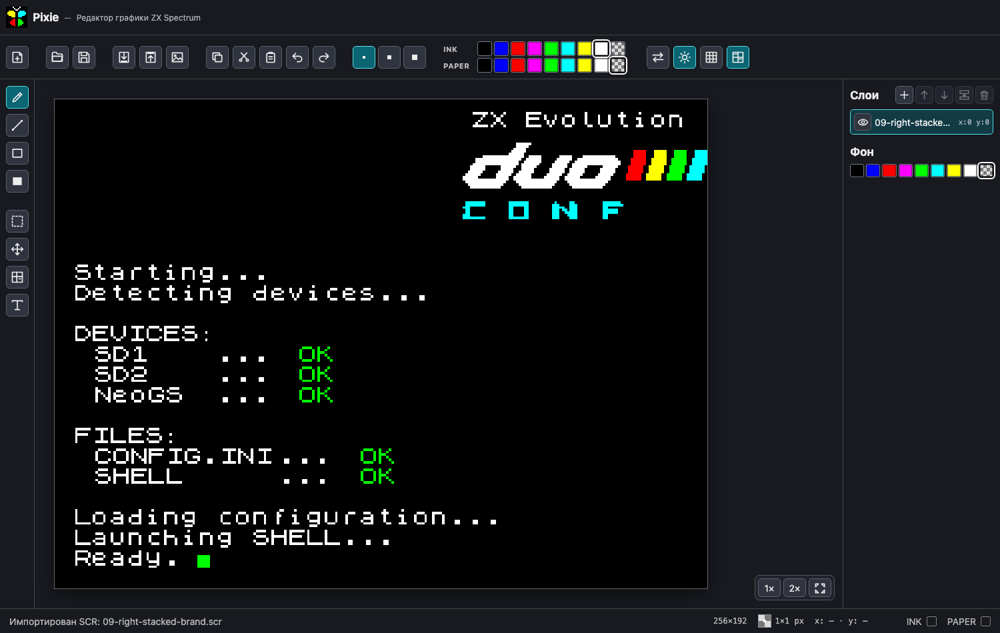

#  Pixie — ZX Spectrum graphics editor

**[Open Pixie in your browser](https://anteo.github.io/pixie/)** · No installation or build step. You can also download the repository and open `index.html` locally.

Pixie lets you draw at individual pixel resolution while seeing how the result will look on a real ZX Spectrum screen. It supports the standard 256×192 bitmap and its 8×8 color attributes, with a switchable ZX attribute preview. Smaller canvases are available for artwork that does not need to fill the screen.

*Tracker Covers artwork loaded from the supplied `image.scr` as an example.*

## What you can do

- **Canvas.** Create a full 256×192 ZX screen or a smaller document.
- **Pixel brush.** Click an empty pixel to draw or a filled pixel to erase; dragging continues the action chosen by the first pixel.
- **Right-button eraser.** Right-click or right-drag to force erasing with the brush, rectangles, or ellipse. The polyline tool does not use the right button.
- **Polylines.** Click successive points to draw connected segments, or drag for a single segment. Hold Shift for horizontal, vertical, or 45° lines; press Escape to end the polyline.
- **Rectangles.** Draw an outline or a filled rectangle with two clicks or one drag. The size is shown beside the pointer while drawing.
- **Ellipses.** Draw an outline with two clicks or one drag; hold Shift for a circle. The selected brush width applies to the outline.
- **Brush size.** Use a shared 1–8 pixel width for the drawing tools.
- **Text.** Type directly on the canvas using the ZX ROM font. Hold Shift when placing text to align its start to an 8×8 cell.
- **INK and PAPER.** Choose colors from swatches and switch BRIGHT on or off.
- **Attribute painting.** Apply the brush, line, rectangle, or ellipse tools to whole 8×8 attribute cells without changing the selected tool.
- **Transparency.** Use transparent INK or PAPER and per-pixel layer masks to reveal artwork below.
- **Layers.** Show, hide, rename, move, reorder, and merge layers.
- **Selections.** Copy, cut, erase, and move a selected region. Pasted artwork stays floating until the selection is dismissed.
- **ZX attribute preview.** When rendering the visible layers together, encode their composition using ZX screen attributes. Each layer itself always keeps attributes per 8×8 cell; switching the preview does not change that. PNG export follows the preview, while SCR export always uses ZX encoding.
- **Grid.** Show 8×8 cell boundaries and, at high zoom, individual pixel boundaries.
- **Zoom and pan.** Pinch to zoom, scroll to pan, or use keyboard zoom presets from 1× to 9×.
- **Undo and redo.** Revert drawing, layer changes, and selections.

## Files

| Format | Use |
| --- | --- |
| `.pixie` | Save and reopen the editable project: canvas size, layers, transparency, and preview setting. The file contents are TOML. |
| `.scr` | Import or export a standard 6,912-byte ZX Spectrum screen. Export requires a full 256×192 canvas. |
| `.png` | Export the visible image, including transparency. The ZX preview switch determines whether colors are encoded to 8×8 attributes first. |

The ZX Spectrum can store only one INK/PAPER color pair and one BRIGHT setting per 8×8 cell. Colors from overlapping or shifted layers may therefore be approximated when ZX preview is enabled or when exporting SCR. Merging layers also encodes the result to ZX attributes.

## Quick start

1. [Open Pixie](https://anteo.github.io/pixie/) or open `index.html` from a local copy.
2. Create a document or import an SCR screen.
3. Save your work as `.pixie`; export `.scr` or `.png` when you need a finished image.

| Shortcut | Action |
| --- | --- |
| `B`, `D`, `R`, `F`, `E`, `S`, `M`, `T` | Brush, polyline, rectangle, filled rectangle, ellipse, selection, move layer, text |
| `A`, `Z`, `G` | Attribute painting, ZX preview, grid |
| `Alt+1`…`Alt+9`, `Alt+0` | Set zoom; fit the canvas |
| `L`, `Shift+L`, `Shift+M` | Add layer, delete layer, merge with layer below |
| `Cmd/Ctrl+O`, `Cmd/Ctrl+S` | Open or save a Pixie project |
| `Cmd/Ctrl+Shift+O`, `Cmd/Ctrl+Shift+S` | Import or export SCR |

The interface follows the browser's language: Russian when its first preferred language is Russian, English otherwise.
