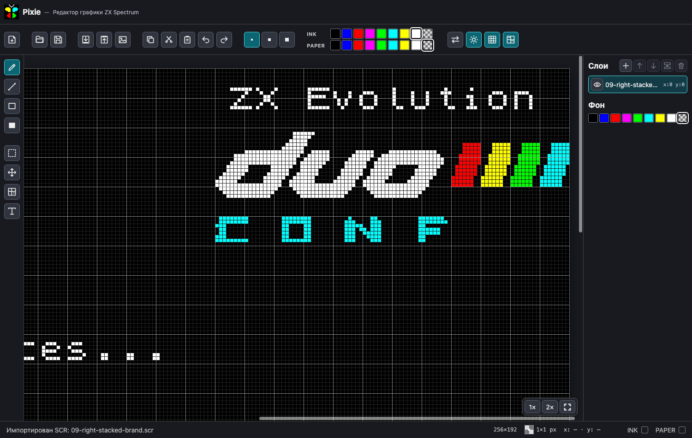

# Pixie

**A browser-based graphics editor for ZX Spectrum screens.**

  

**[Open Pixie in your browser](https://anteo.github.io/pixie/)** · No installation or build step. You can also download the repository and open `index.html` locally.

Pixie lets you draw at individual pixel resolution while seeing how the result will look on a real ZX Spectrum screen. It supports the standard 256×192 bitmap and its 8×8 color attributes, with a switchable ZX attribute preview. Smaller canvases are available for artwork that does not need to fill the screen.

*A DuoConf boot-screen sketch loaded as an example SCR. The artwork is an example; Pixie is a general-purpose editor.*

## What you can do

- Draw with a pixel brush, polylines, outlined rectangles, and filled rectangles. Choose a brush size from 1 to 8 pixels.
- Type directly on the canvas with the ZX ROM font. Hold **Shift** when placing text or a selection to align it to 8×8 cells.
- Work with transparent layers: show, hide, move, reorder, rename, and merge them. Use a floating selection for moving or pasting artwork.
- Edit colors with INK and PAPER swatches, or paint whole 8×8 attribute cells. The transparent swatch lets underlying layers show through.
- Pan with a mouse wheel or trackpad scroll, zoom with pinch, and toggle cell and pixel grids. Keyboard zoom presets cover 1× through 9×.
- Switch ZX attribute preview on or off. **PNG export follows the current preview**; SCR export always uses ZX screen encoding.

*At high zoom, individual pixels and attribute cell boundaries are visible.*

## Files

| Format | Use |
| --- | --- |
| `.pixie` | Save and reopen the editable project: canvas size, layers, transparency, and preview setting. The file contents are TOML. |
| `.scr` | Import or export a standard 6,912-byte ZX Spectrum screen. Export requires a full 256×192 canvas. |
| `.png` | Export the visible image, including transparency. The ZX preview switch determines whether colors are encoded to 8×8 attributes first. |

The ZX Spectrum can store only one INK/PAPER color pair and one BRIGHT setting per 8×8 cell. Colors from overlapping or shifted layers may therefore be approximated when ZX preview is enabled or when exporting SCR. Merging layers also encodes the result to ZX attributes.

## Quick start

1. [Open Pixie](https://anteo.github.io/pixie/) or open `index.html` from a local copy.
2. Create a document or import an SCR screen.
3. Save your work as `.pixie`; export `.scr` or `.png` when you need a finished image.

| Shortcut | Action |
| --- | --- |
| `B`, `D`, `R`, `F`, `S`, `M`, `T` | Brush, polyline, rectangle, filled rectangle, selection, move layer, text |
| `A`, `Z`, `G` | Attribute painting, ZX preview, grid |
| `Alt+1`…`Alt+9`, `Alt+0` | Set zoom; fit the canvas |
| `L`, `Shift+L`, `Shift+M` | Add layer, delete layer, merge with layer below |
| `Cmd/Ctrl+O`, `Cmd/Ctrl+S` | Open or save a Pixie project |
| `Cmd/Ctrl+Shift+O`, `Cmd/Ctrl+Shift+S` | Import or export SCR |

The interface follows the browser's language: Russian when its first preferred language is Russian, English otherwise.
