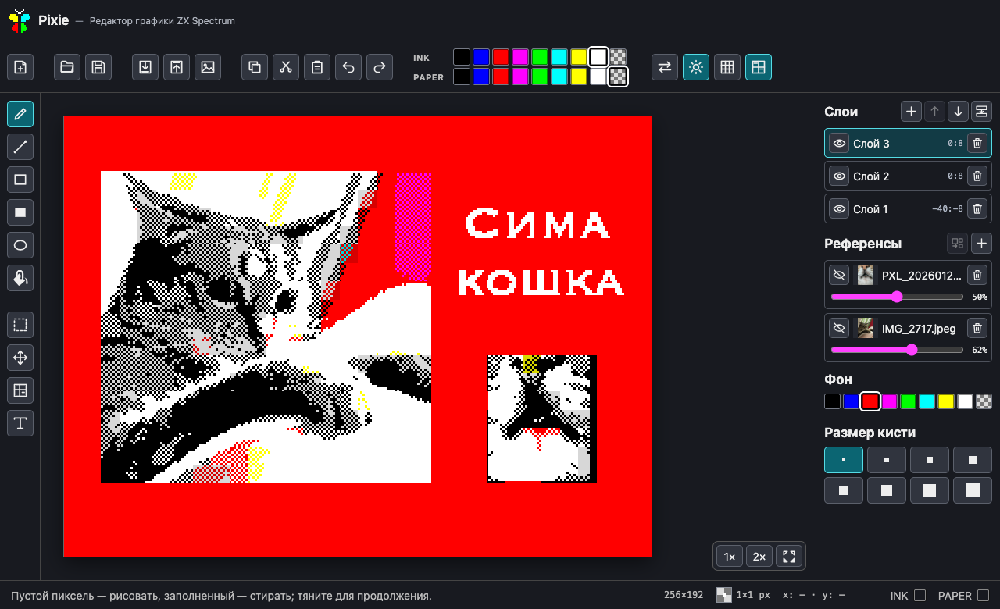
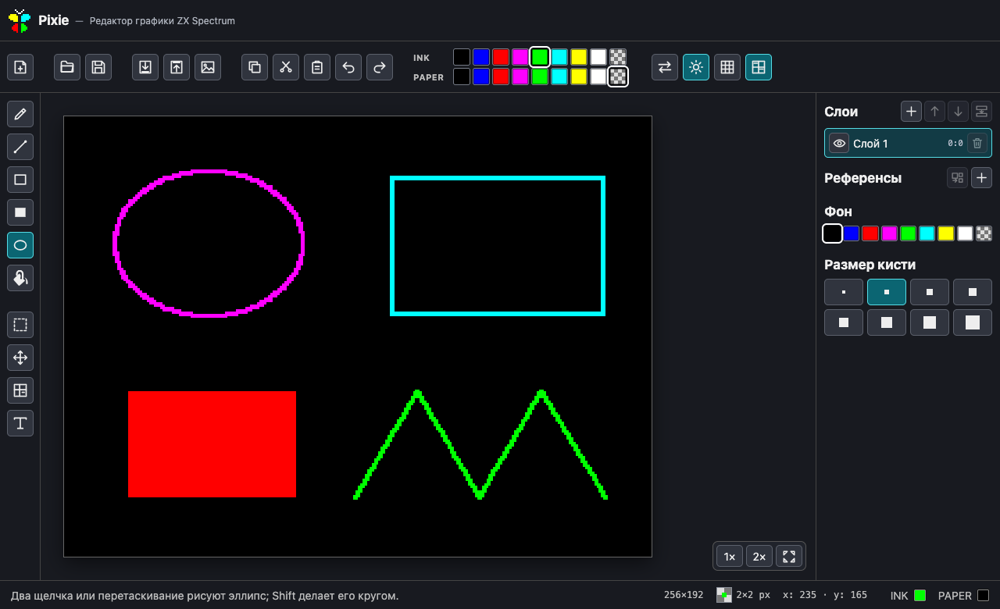

#  Pixie — Редактор графики ZX Spectrum

**[Открыть Pixie в браузере](https://anteo.github.io/pixie/)** · Установка и сборка не нужны. Можно также скачать репозиторий и открыть `index.html` локально.

Pixie позволяет рисовать отдельными пикселями и сразу видеть, как изображение будет выглядеть на настоящем экране ZX Spectrum. Поддерживаются стандартный растр 256×192, цветовые атрибуты 8×8 и переключаемый предпросмотр ограничений ZX. Для небольших рисунков можно создать документ меньшего размера.

## Скриншоты

Нажмите на превью, чтобы открыть изображение в полном размере.

<table>
  <tr><th>Рисунок на экране ZX</th><th>Пиксельные шрифты</th><th>Примитивы</th><th>Трассировка референса</th></tr>
  <tr>
    <td></td>
    <td></td>
    <td></td>
    <td></td>
  </tr>
</table>

## Возможности

- **Холст.** Создание полного экрана ZX 256×192 или документа меньшего размера.
- **Пиксельное перо.** Щелчок по пустому пикселю рисует, по заполненному — стирает; при перетаскивании сохраняется действие, выбранное первым пикселем.
- **Текст.** Выбор шрифта ZX ROM или растеризация шрифта браузера в пиксели. Список установленных шрифтов можно запросить, если браузер поддерживает эту возможность; название шрифта также можно ввести вручную. Enter или щелчок по холсту создаёт плавающее выделение, которое можно переместить или масштабировать перед применением. Shift при размещении привязывает начало строки к знакоместу 8×8.
- **INK и PAPER.** Выбор цветов из образцов и переключение BRIGHT.
- **Предпросмотр атрибутов ZX.** При рендере видимых слоёв их композиция кодируется с ограничениями экрана ZX. Внутри каждого слоя атрибуты всегда привязаны к знакоместам 8×8; переключатель предпросмотра этого не меняет. Экспорт PNG следует предпросмотру, а SCR всегда использует ZX-кодирование.
- **Слои.** Включение и выключение видимости, переименование, перемещение, изменение порядка, слияние и удаление кнопкой в строке слоя. Содержимое слоя может выходить за пределы документа при перемещении и редактировании; экспорт включает только область документа. Кнопка видимости переключает **вкл → выкл → соло** и показывает букву S в режиме соло; клавиша `V` переключает активный слой. В соло можно включить несколько слоёв одновременно.
- **Референсы.** PNG, JPEG, WebP или GIF можно загрузить между фоном и рисунком. У каждого референса свои видимость и непрозрачность; строки справа можно перетаскивать для изменения порядка. Выбранный референс перемещается за изображение или рамку, а его размер меняется за угол. Shift сохраняет пропорции. Референсы масштабируются вместе с холстом и не попадают в экспорт SCR и PNG.
- **Трассировка референса.** Выберите референс и нажмите кнопку трассировки (`K`); это работает и при выключенной видимости референса. Pixie сразу покажет результат для всего референса или для уже выделенной области. Тяните за край рамки, чтобы переместить её, за маркеры — чтобы изменить размер; нажатие внутри или снаружи рамки начинает новое выделение. Undo/Redo отменяют и повторяют изменения рамки и настроек, не закрывая трассировку. **Применить** или Enter закрепляет пиксели на активном слое; **Отмена** или Escape убирает предпросмотр. Остальные референсы на время трассировки скрываются. Copy копирует трассированные пиксели без применения, Cut копирует их и отменяет трассировку. Непрозрачность референса на результат не влияет.
- **Настройки преобразования.** Кнопка преобразования показывает справа яркость, контраст, насыщенность, уровни, упрощение, шум, дизеринг и согласование цветов соседних знакомест. Можно выбрать Флойда — Стейнберга в линейном RGB, Sierra, Atkinson, Bayer 4×4/8×8, шахматный дизеринг или его отсутствие. Изменение настроек сразу обновляет плавающее выделение.
- **Выделение.** Копирование, вырезание, очистка и перенос области. Стрелки сдвигают выделение на пиксель, Shift+стрелки привязывают его к следующей границе знакоместа 8×8. Перемещённое изображение остаётся плавающим до нажатия Enter или снятия выделения.
- **Масштабирование выделения.** Тяните за края или углы рамки, чтобы изменить размер пиксельного изображения; Shift делает размер кратным 8. Пока выделение плавает, каждый новый размер вычисляется из исходных пикселей: сужение и последующее расширение не накапливают потери деталей.
- **Ломаные линии.** Последовательные щелчки задают связанные отрезки, перетаскивание — один отрезок. Shift ограничивает направление горизонталью, вертикалью или диагональю 45°; Escape завершает ломаную.
- **Прямоугольники.** Контурный или закрашенный прямоугольник рисуется двумя щелчками либо перетаскиванием. Во время рисования рядом с указателем показан размер.
- **Эллипсы.** Контур рисуется двумя щелчками или перетаскиванием; Shift фиксирует круг. К контуру применяется выбранная толщина.
- **Заливка.** Заполнение связной области активного слоя с учётом цветов и прозрачности пикселей как границ.
- **Прозрачность.** Прозрачные INK и PAPER вместе с попиксельной маской слоя открывают рисунок под ним. Рисование с прозрачным PAPER сохраняет прежние фоновые пиксели и их цвет.
- **Рисование атрибутами.** Перо, линия, прямоугольники, эллипс и заливка работают с целыми знакоместами 8×8 без смены выбранного инструмента.
- **Предпросмотр соло.** При включённом предпросмотре ZX все включённые слои рендерятся вместе с ограничениями атрибутов; полученный результат затемняется вне пикселей слоёв соло. Их собственные пиксели остаются яркими и накладываются в порядке слоёв, а строки остальных слоёв на панели становятся полупрозрачными. При выключенном ZX затемнённая область показывает обычное наложение слоёв. Соло действует на холсте; экспорт сохраняет обычное изображение включённых слоёв.
- **Стирание правой кнопкой.** Правая кнопка стирает пером, прямоугольниками и эллипсом. Для заливки она очищает связную область. Для ломаной правая кнопка не используется.
- **Размер кисти.** Общий для рисующих инструментов размер от 1 до 8 пикселей выбирается на правой панели.
- **Сетка.** Границы знакомест 8×8 и, при большом масштабе, отдельных пикселей.
- **Масштаб и перемещение.** Pinch меняет масштаб, прокрутка перемещает холст; доступны клавиатурные масштабы от 1× до 9×.
- **Отмена и повтор.** Можно отменять рисование, изменения слоёв и выделения. Во время незавершённой протяжки или предпросмотра фигуры Undo сначала отменяет текущее действие.
- **Несохранённые изменения.** При создании документа, открытии другого проекта и импорте SCR редактор предлагает сохранить изменённую работу. Импортированный SCR считается несохранённым, пока проект не записан в `.pixie`.

## Форматы

| Формат | Назначение |
| --- | --- |
| `.pixie` | Сохранение редактируемого проекта: размер холста, слои, прозрачность, состояние соло, встроенные референсы, настройки преобразования и режим предпросмотра. Внутри используется TOML. |
| `.scr` | Импорт и экспорт стандартного экрана ZX Spectrum размером 6912 байт. Для экспорта нужен полный холст 256×192. |
| `.png` | Экспорт видимого изображения с прозрачностью. Переключатель предпросмотра определяет, будут ли цвета сначала сведены к атрибутам 8×8. |

В браузерах с File System Access API первое сохранение проекта открывает системный диалог выбора файла, а следующие записывают изменения в тот же `.pixie`. Открытый через редактор проект тоже сохраняет связь с исходным файлом. В остальных браузерах вместо записи выполняется загрузка копии: напрямую перезаписать локальный файл браузер не позволяет.

ZX Spectrum хранит только одну пару цветов INK/PAPER и один признак BRIGHT на знакоместо 8×8. Поэтому цвета пересекающихся или сдвинутых слоёв могут приближаться при включённом предпросмотре ZX и при экспорте SCR. Слияние слоёв также кодирует результат в атрибуты ZX.

## Начало работы

1. [Откройте Pixie](https://anteo.github.io/pixie/) или локальный `index.html`.
2. Создайте документ либо импортируйте экран SCR.
3. Сохраните работу в `.pixie`; готовый рисунок экспортируйте в `.scr` или `.png`.

| Клавиши | Действие |
| --- | --- |
| `B`, `D`, `R`, `F`, `E`, `P`, `S`, `M`, `T` | Кисть, ломаная, прямоугольник, закрашенный прямоугольник, эллипс, заливка, выделение, перемещение слоя, текст |
| `A`, `Z`, `G` | Рисование атрибутами, предпросмотр ZX, сетка |
| `K`, `Enter`, `Escape` | Начать трассировку выбранного референса; применить или отменить предпросмотр |
| `Стрелки`, `Shift+стрелки` | Сдвинуть выделение на 1 пиксель или до следующей границы знакоместа 8×8; при инструменте перемещения — сдвинуть слой; иначе прокрутить холст (с Shift быстрее) |
| `Enter` | Закрепить плавающее выделение и убрать рамку |
| `Alt+1`…`Alt+9`, `Alt+0` | Масштаб и вписывание холста |
| `Alt+Shift+1`…`Alt+Shift+8` | Размер кисти от 1 до 8 пикселей |
| `L`, `Shift+L`, `Shift+M` | Добавить слой, удалить слой, слить с нижним |
| `Cmd/Ctrl+O`, `Cmd/Ctrl+S` | Открыть или сохранить проект Pixie |
| `Cmd/Ctrl+Shift+O`, `Cmd/Ctrl+Shift+S` | Импортировать или экспортировать SCR |

Язык интерфейса выбирается по первому предпочитаемому языку браузера: русский для `ru`, английский для остальных.

## Структура кода

`pixie.app.js` хранит состояние документа и координирует действия редактора. Остальные скрипты в `index.html` сгруппированы по назначению:

- `pixie.core.js` — битовая карта, геометрия, выделения, сборка атрибутов ZX, вывод изображения и данные проекта.
- `pixie.text.js` — растеризация шрифтов и ввод текста.
- `pixie.trace.js` — преобразование референсов и настройки трассировки.
- `pixie.ui.js` — панели, размещение референсов, масштаб, файловые диалоги и локализация. Русские строки находятся в `pixie.ru.js`.

Скрипты подключены обычными тегами `defer` в порядке зависимостей. Поэтому локальный `index.html` по-прежнему можно открыть через `file://`.
