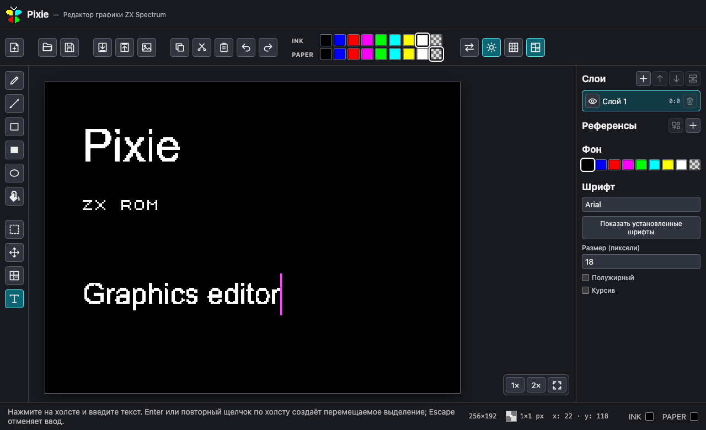
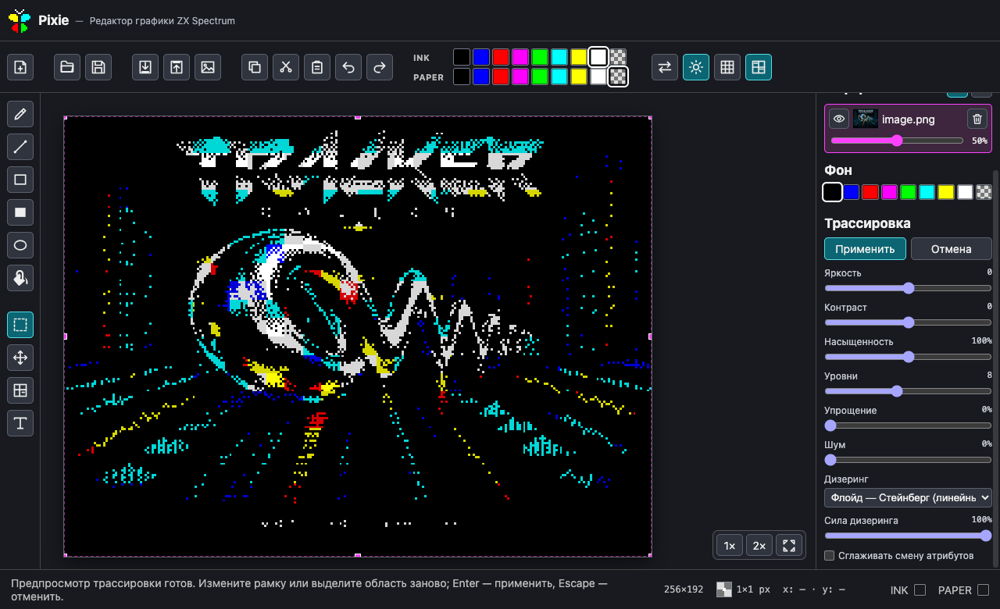

#  Pixie — Редактор графики ZX Spectrum

**[Открыть Pixie в браузере](https://anteo.github.io/pixie/)** · Установка и сборка не нужны. Можно также скачать репозиторий и открыть `index.html` локально.

Pixie позволяет рисовать отдельными пикселями и сразу видеть, как изображение будет выглядеть на настоящем экране ZX Spectrum. Поддерживаются стандартный растр 256×192, цветовые атрибуты 8×8 и переключаемый предпросмотр ограничений ZX. Для небольших рисунков можно создать документ меньшего размера.

## Скриншоты

Нажмите на превью, чтобы открыть изображение в полном размере.

<table>
  <tr><th>Рисунок на экране ZX</th><th>Пиксельные шрифты</th><th>Примитивы</th><th>Трассировка референса</th></tr>
  <tr>
    <td></td>
    <td></td>
    <td></td>
    <td></td>
  </tr>
</table>

## Возможности

- **Пиксельная кисть.** Квадрат, круг или спрей размером от 1 до 64 пикселей. Рисует или стирает в зависимости от первого пикселя; протяжка продолжает выбранное действие.
- **Текст.** Шрифт ZX ROM или шрифты браузера преобразуются в пиксели. Во время набора текст можно перетащить за черту под ним; Enter создаёт плавающее выделение, которое можно переместить или масштабировать до закрепления.
- **Предпросмотр атрибутов ZX.** Показывает общую композицию слоёв с цветовыми ограничениями ZX. Внутри каждого слоя атрибуты остаются привязанными к знакоместам 8×8; переключатель влияет на общий предпросмотр и экспорт PNG.
- **Слои.** Независимое перемещение, изменение порядка, слияние и управление видимостью. При редактировании рисунок может выходить за границы документа.
- **Референсы.** Изображения размещаются под рисунком; их можно перемещать, масштабировать, переставлять и менять прозрачность, не добавляя в экспорт.
- **Трассировка референса.** Преобразует выбранный референс или его часть в плавающий предпросмотр пикселей на активном слое.
- **Настройки трассировки.** Цвет, шум, дизеринг и согласование цветов соседних знакомест настраиваются с мгновенным предпросмотром.
- **Выделение.** Пиксели можно копировать, вырезать, очищать и перемещать в плавающей рамке до применения или отмены.
- **Масштабирование выделения.** Каждый новый размер вычисляется из исходных пикселей, поэтому повторное изменение размера не накапливает потери деталей.
- **Прозрачность.** Прозрачные INK и PAPER и попиксельные маски слоёв открывают нижний рисунок.
- **Рисование атрибутами.** Рисующие инструменты работают с целыми знакоместами 8×8 вместо отдельных пикселей.
- **Предпросмотр соло.** Один или несколько слоёв выделяются на фоне приглушённых остальных, в том числе при общем рендере атрибутов ZX.
- **Ломаные линии.** Связанные отрезки с ограничением направления по горизонтали, вертикали или диагонали 45°.
- **Прямоугольники.** Контурные и закрашенные фигуры.
- **Эллипсы.** Контурные эллипсы с возможностью зафиксировать круг.
- **Заливка.** Заполнение связной области активного слоя.
- **Стирание правой кнопкой.** Принудительное стирание пером, прямоугольниками, эллипсом или заливкой.
- **Навигация.** Масштаб и прокрутка холста; при необходимости появляется компактный навигатор с рамкой видимой области.

## Форматы

| Формат | Назначение |
| --- | --- |
| `.pixie` | Сохранение редактируемого проекта: размер холста, слои, прозрачность, состояние соло, встроенные референсы, настройки преобразования и режим предпросмотра. Внутри используется TOML. |
| `.scr` | Импорт и экспорт стандартного экрана ZX Spectrum размером 6912 байт. Для экспорта нужен полный холст 256×192. |
| `.png` | Экспорт видимого изображения с прозрачностью. Переключатель предпросмотра определяет, будут ли цвета сначала сведены к атрибутам 8×8. |

В браузерах с File System Access API первое сохранение проекта открывает системный диалог выбора файла, а следующие записывают изменения в тот же `.pixie`. Открытый через редактор проект тоже сохраняет связь с исходным файлом. В остальных браузерах вместо записи выполняется загрузка копии: напрямую перезаписать локальный файл браузер не позволяет.

ZX Spectrum хранит только одну пару цветов INK/PAPER и один признак BRIGHT на знакоместо 8×8. Поэтому цвета пересекающихся или сдвинутых слоёв могут приближаться при включённом предпросмотре ZX и при экспорте SCR. Слияние слоёв также кодирует результат в атрибуты ZX.

## Начало работы

1. [Откройте Pixie](https://anteo.github.io/pixie/) или локальный `index.html`.
2. Создайте документ либо импортируйте экран SCR.
3. Сохраните работу в `.pixie`; готовый рисунок экспортируйте в `.scr` или `.png`.

| Клавиши | Действие |
| --- | --- |
| `B`, `D`, `R`, `F`, `E`, `P`, `S`, `M`, `T` | Кисть, ломаная, прямоугольник, закрашенный прямоугольник, эллипс, заливка, выделение, перемещение слоя, текст |
| `A`, `Z`, `G` | Рисование атрибутами, предпросмотр ZX, сетка |
| `K`, `Enter`, `Escape` | Начать трассировку выбранного референса; применить или отменить предпросмотр |
| `Стрелки`, `Shift+стрелки` | Сдвинуть выделение на 1 пиксель или до следующей границы знакоместа 8×8; при инструменте перемещения — сдвинуть слой; иначе прокрутить холст (с Shift быстрее) |
| `Shift` при перетаскивании слоя | Привязать смещение слоя к границам знакомест 8×8 |
| `Enter` | Закрепить плавающее выделение и убрать рамку |
| `Alt+1`…`Alt+9`, `Alt+0` | Масштаб и вписывание холста |
| `Alt+Shift+1`…`Alt+Shift+8` | Размер кисти от 1 до 8 пикселей; больший размер задаётся слайдером |
| `L`, `Shift+L`, `Shift+M` | Добавить слой, удалить слой, слить с нижним |
| `V`, `Shift+V` | Включить или выключить активный слой либо его режим соло |
| `Cmd/Ctrl+O`, `Cmd/Ctrl+S` | Открыть или сохранить проект Pixie |
| `Cmd/Ctrl+Shift+O`, `Cmd/Ctrl+Shift+S` | Импортировать или экспортировать SCR |

Язык интерфейса выбирается по первому предпочитаемому языку браузера: русский для `ru`, английский для остальных.
